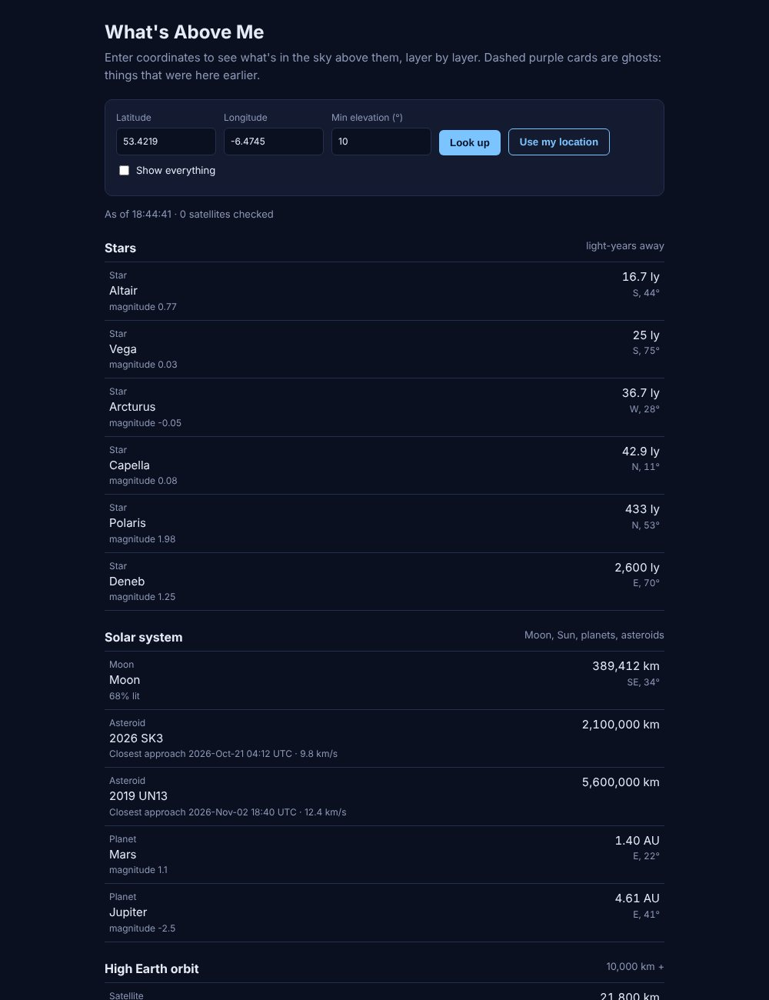
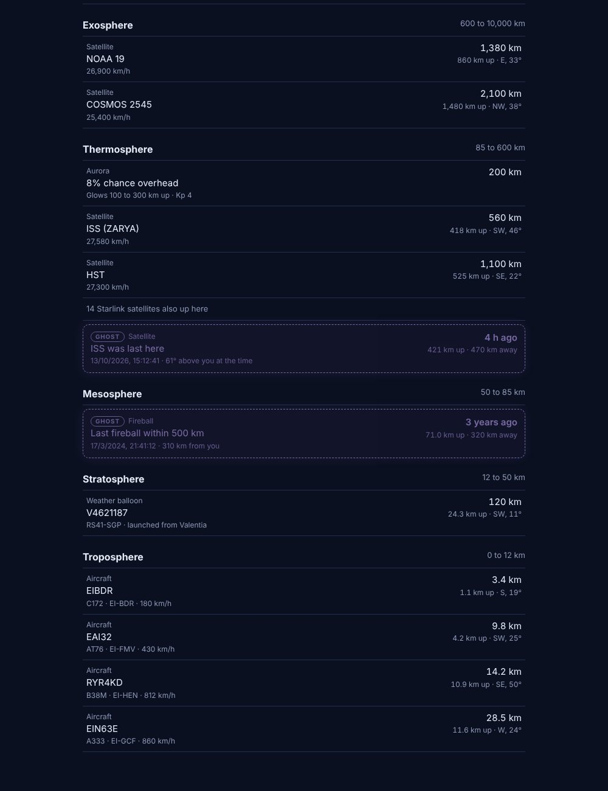

# What's Above Me: v4 (filter, ghosts, backup data)

Cuts the list down to the interesting stuff, adds **ghosts** (the last time something was overhead), and keeps satellites working even when CelesTrak blocks you.

## Screenshots

| Filtered layers | Ghosts |
|---|---|
|  |  |

*Shown with sample data.*

## What's new since v3

| v3 | v4 |
|---|---|
| Every result shown (hundreds of Starlinks) | "Interesting only" by default, with a **Show everything** switch |
| No history | Ghosts: when the ISS and Tiangong were last overhead, and the last fireball nearby |
| Satellites vanish if CelesTrak blocks you with no saved copy | Falls back to the small station + brightest groups |
| Fireball shown as a faded row | Fireball becomes a ghost with "how long ago" |

## Setup

Needs Node.js 18 or newer.

```bash
npm install
npm start
```

Open http://localhost:3000, enter coordinates and press **Look up**.

## Project structure

```
v4/
├── server.js              Express server and the /api/above route
├── layers.js              Layer definitions + groupIntoLayers()
├── sources/
│   ├── http.js            getJson() with headers + timeout
│   ├── geo.js             Shared maths
│   ├── satellites.js      TLEs with disk cache + fallback, exports loadTles()
│   ├── ghosts.js          NEW: last time the space stations were overhead
│   ├── aircraft.js
│   ├── balloons.js
│   ├── aurora.js
│   ├── fireballs.js       Now returns a ghost
│   ├── asteroids.js
│   ├── solar-system.js
│   └── stars.js
└── public/
    ├── index.html
    ├── style.css          Ghost card styling
    └── app.js             The "interesting" filter + ghost cards
```

## How ghosts work

**Space stations (`sources/ghosts.js`)**

SGP4 can run backwards as easily as forwards, so no history is needed:

1. Start at now and step back 20 seconds at a time, up to 3 days.
2. Wait until the station has been **below** the cutoff (so a pass happening right now isn't counted as a ghost).
3. The first moment it's above the cutoff after that is the last time it was overhead.

It reuses the same TLEs as the live satellites via `loadTles()`. Accuracy drops the further back it goes, because TLEs drift.

**Fireballs:** the newest recorded fireball within 500 km gets `ghost: true` and a `seenAt` date.

Ghost items look like this:

```json
{
  "kind": "Satellite",
  "name": "ISS was last here",
  "detail": "61° above you at the time",
  "seenAt": "2026-10-13T16:34:41.357Z",
  "altitudeKm": 421, "distanceKm": 470, "elevation": 61, "azimuth": 140,
  "ghost": true
}
```

## The "interesting only" filter

Runs in the browser (`public/app.js`), so the switch can redraw instantly without asking the server again.

| Kind | Kept |
|---|---|
| Planes | 3 nearest + the highest |
| Satellites | ISS, Tiangong, Hubble always; 3 nearest others |
| Starlink, OneWeb, Iridium etc. | Collapsed into one line, e.g. "84 Starlink satellites also up here" |
| Weather balloons | All (they're rare) |
| Aurora | Only if the chance is above 0 |
| Sun, Moon | Always if up |
| Planets | Only if bright enough to see (magnitude under 5) |
| Stars | 6 brightest |
| Asteroids | 2 closest |
| Ghosts | Always |

## Satellite backup data

CelesTrak returns `403` if you download the same file more than once in about 2 hours. `satellites.js` now handles every case:

| Situation | What happens |
|---|---|
| Saved copy under 2 hours old | Use it, don't contact CelesTrak |
| Refresh works | Save and use the new copy |
| Refresh fails, old copy exists | Use the old copy; status shows "using 5h old orbit data" |
| Refresh fails, no copy | Download the small `stations` + `visual` groups (ISS, Tiangong, ~100 brightest); retry the full list in 15 minutes |
| Two requests at once | Both wait on one shared download |

The note shows up in `sources.satellites`, e.g. `"ok (full list blocked, showing bright satellites only)"`.

## API

Same as v3, plus ghost items (`ghost: true`, `seenAt`) inside the layers and an optional note on `sources.satellites`.

```
GET /api/above?lat=53.4219&lon=-6.4745&minEl=20
```

## Limits

- Still a list, no scene or visuals
- Coordinates only, no place search
- Ghosts only for the space stations and fireballs

## Data sources

| Data | Source | Key needed |
|---|---|---|
| Satellites | [CelesTrak](https://celestrak.org) + [satellite.js](https://github.com/shashwatak/satellite-js) | No |
| Planes | [adsb.lol](https://api.adsb.lol) | No |
| Weather balloons | [SondeHub](https://sondehub.org) | No |
| Aurora | [NOAA SWPC](https://www.swpc.noaa.gov) | No |
| Fireballs | [NASA CNEOS](https://cneos.jpl.nasa.gov/fireballs/) | No |
| Asteroids | [JPL SBDB Close-Approach API](https://ssd-api.jpl.nasa.gov/doc/cad.html) | No |
| Sun, Moon, planets, stars | [astronomy-engine](https://github.com/cosinekitty/astronomy) | No |
