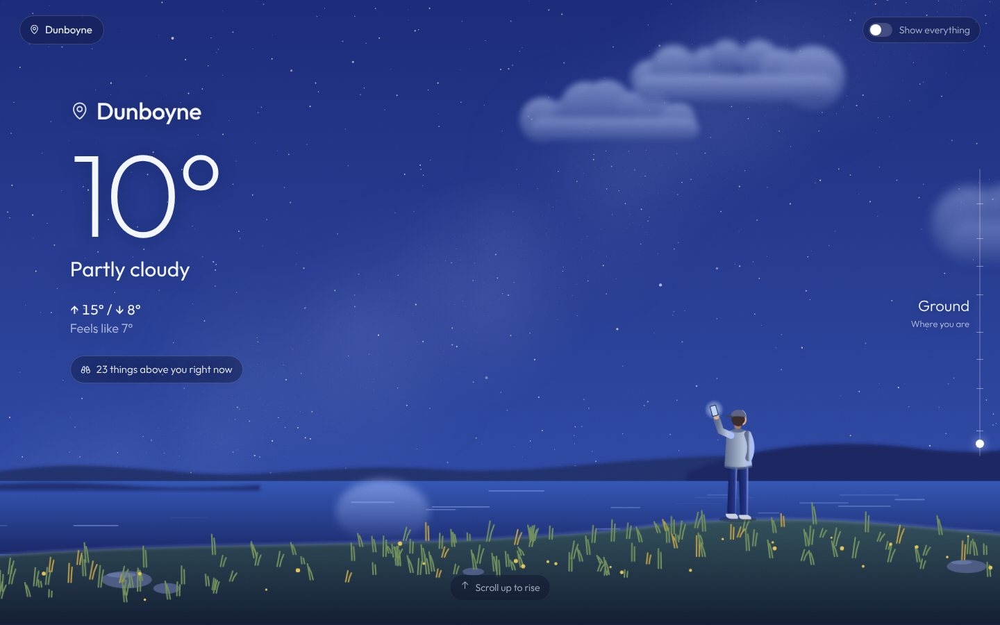
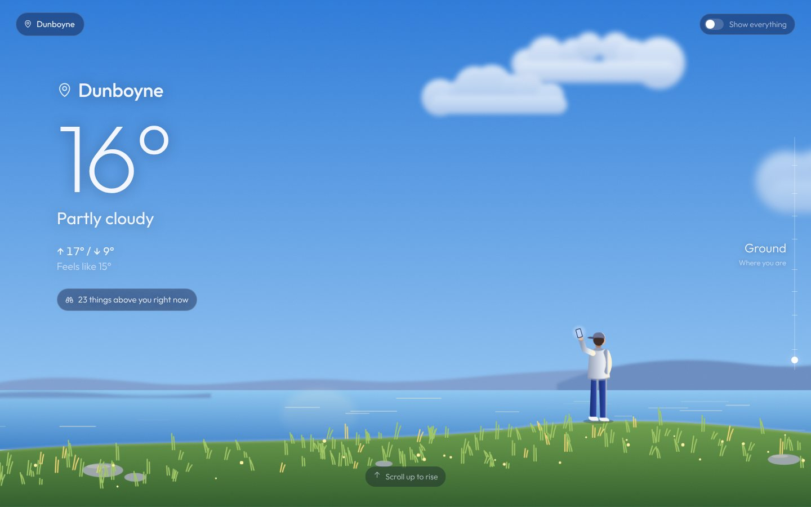
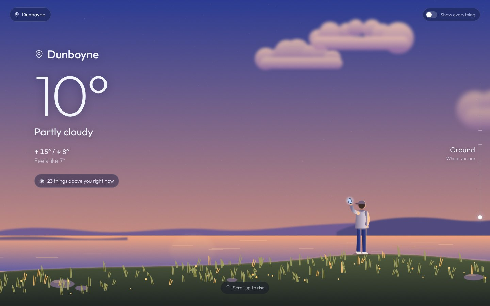
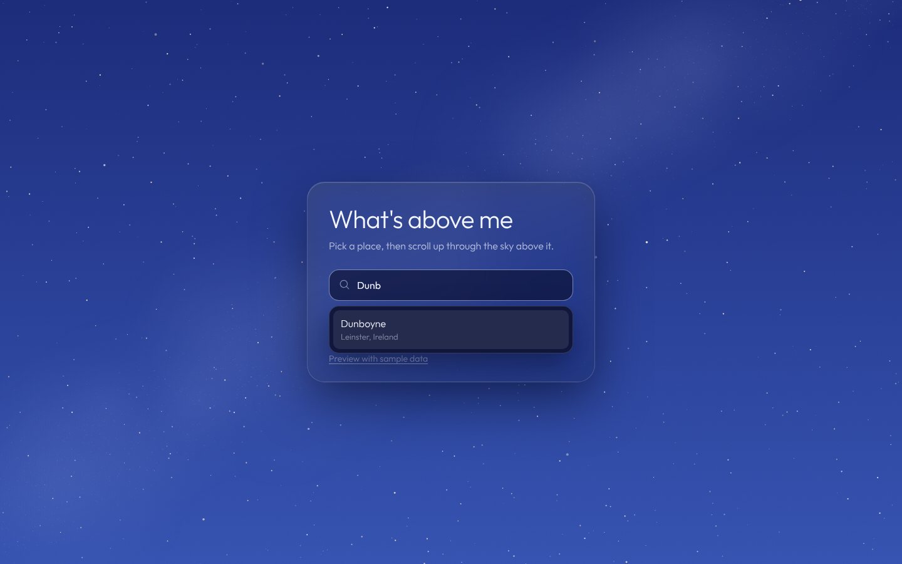
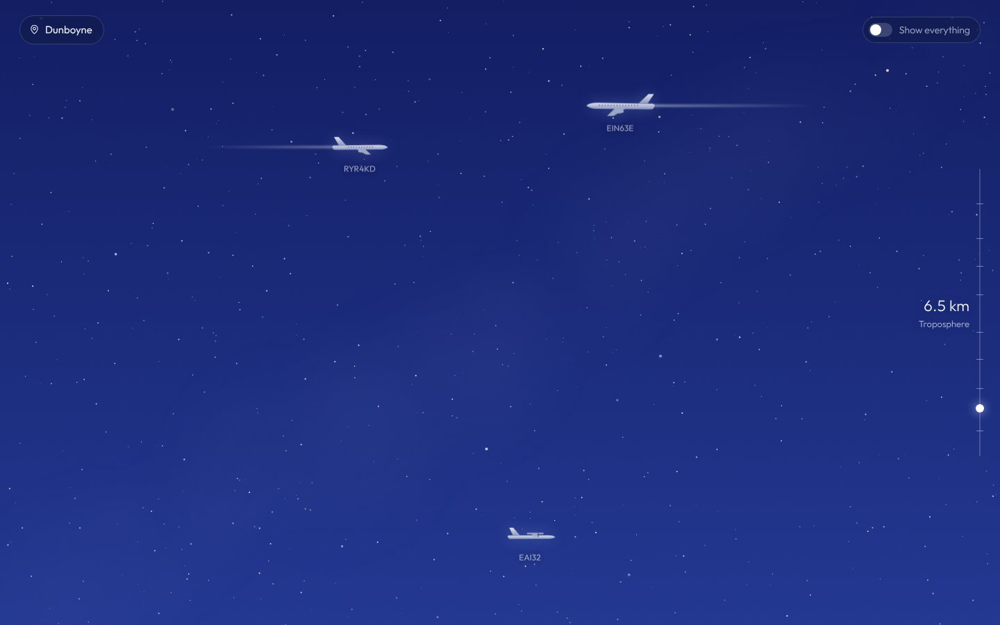
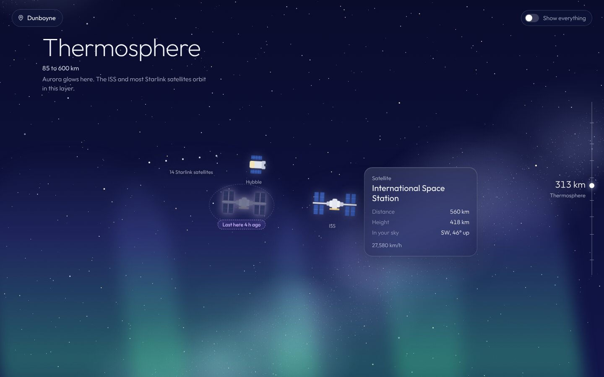
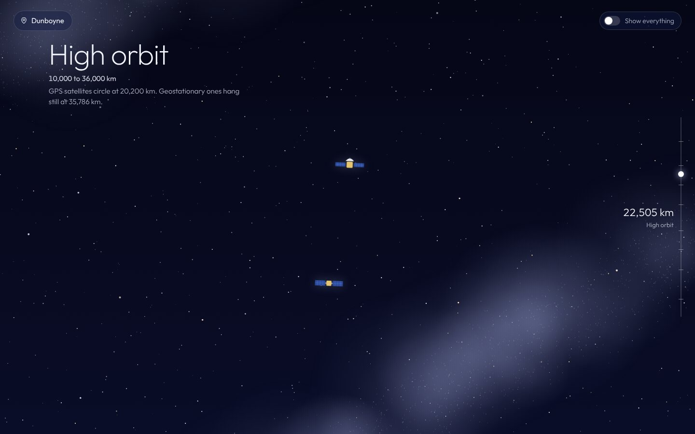
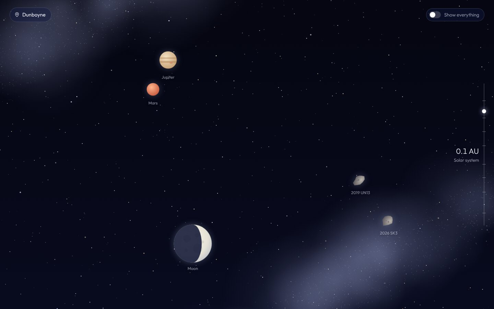
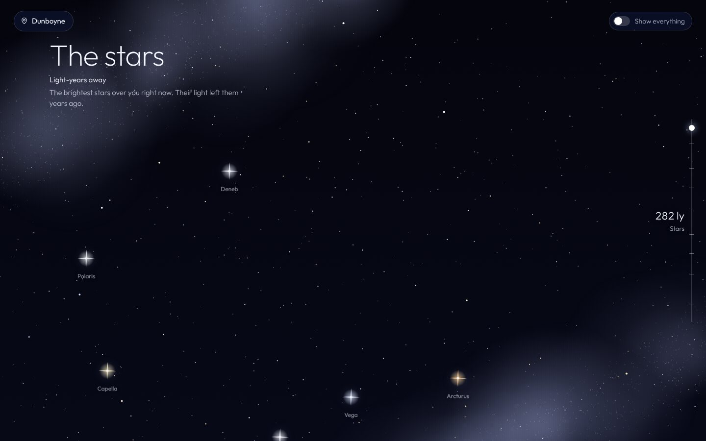

# What's Above Me: v6 (the finished app)

Search a place, land in an illustrated scene, and scroll **up** from the ground through every layer of the sky to the stars. Everything above you is drawn where it really is: planes, weather balloons, aurora, the ISS, satellites, the Moon in its real phase, planets and stars. Hover anything for details.

The visual style is inspired by the Samsung Weather app. All the art is original SVG drawn in code.

## Screenshots



| Day | Sunset |
|---|---|
|  |  |

| Place search | Planes |
|---|---|
|  |  |

| Hover card + ghost | High orbit |
|---|---|
|  |  |

| Solar system | Stars |
|---|---|
|  |  |

*Shown with the built-in sample data (Preview with sample data). Time of day is set from the real sun position.*

## What's new since v5

| v5 | v6 |
|---|---|
| Glowing dots | **Illustrations** for everything: 4 plane types facing their real heading, balloon, ISS, Tiangong, Hubble, 3 satellite designs, Starlink trains, fireball, Moon in its real phase, planets, coloured stars, asteroids |
| Plain hills | Full landscape: lake with moon/sun reflection, grass, rocks, and an **animated person** looking up |
| Fades only | Camera pull-in, parallax, layer reveals, twinkling, drifting clouds, blinking plane lights, aurora curtains, shooting stars |
| Browser tooltips | Glass **hover cards** |
| No weather visuals | Clouds match the condition, plus rain, snow and lightning |
| Ghost markers | Glowing ghost outlines with a pulsing dashed ring |
| No offline mode | **Preview with sample data** (`?demo=1`) |
| | Milky Way, film grain, Outfit font, Phosphor icons |
| | Dockerfile for self-hosting |

## Setup

Needs Node.js 18 or newer.

```bash
npm install
npm start
```

Open http://localhost:3000 in Chrome or Edge. **Preview with sample data** on the first screen works even when the live APIs are down.

### Docker

```bash
docker build -t whats-above-me .
docker run -d -p 3000:3000 --name whats-above-me whats-above-me
```

## Project structure

```
v6/
├── server.js              /api/above (+ ?demo=1), /api/geocode, /api/reverse
├── layers.js              Layer definitions + groupIntoLayers()
├── demo.js                NEW: sample sky for preview mode
├── Dockerfile             NEW
├── sources/
│   ├── http.js            getJson() with headers + timeout
│   ├── geo.js             Look angles, ground distance
│   ├── satellites.js      TLEs: disk cache, shared download, fallbacks
│   ├── ghosts.js          Last time the space stations were overhead
│   ├── aircraft.js        adsb.lol
│   ├── balloons.js        SondeHub
│   ├── aurora.js          NOAA OVATION + Kp
│   ├── fireballs.js       NASA CNEOS
│   ├── asteroids.js       JPL close approaches
│   ├── solar-system.js    Sun, Moon, planets, moon phase, time of day
│   ├── stars.js           Bright named stars
│   ├── weather.js         Open-Meteo
│   └── places.js          Place search + town name
└── public/
    ├── index.html         Entry card, top bar, altimeter, world, hover card
    ├── style.css          Time-of-day palettes, every animation
    ├── art.js             NEW: every illustration as an SVG string
    └── app.js             Scene, scrolling, canvases, hover cards, entry flow
```

## How it works

### Illustrations (`public/art.js`)
- Every drawing is a function that returns an SVG string, e.g. `Art.plane(item)` or `Art.moon(item)`.
- A seeded random generator (`rng(seed)`) gives each object a consistent look, so the same satellite always gets the same design.
- **Planes:** the shape comes from the aircraft type code (wide-body, narrow-body, turboprop, small) and flips to face its real heading. Contrails appear above 7.5 km.
- **Moon:** drawn from `phaseDeg`. A half-disc plus an ellipse makes the terminator, so the shape is the real phase.
- **Colours:** anything that should follow time of day uses CSS variables (`var(--grass-1)`, `var(--plane-top)`...).

### Time of day and weather (`public/style.css`)
`<body data-phase="night" data-weather="rain">` swaps CSS variables for the land, water, grass, clouds, planes and the person's clothes. One attribute change recolours the whole scene.

### Motion
- **Pull-in:** the entry card fades and the world scales in from slightly zoomed.
- **Parallax:** near objects (planes) move slightly faster than the page, far ones (stars, planets) slower. Done in the same `requestAnimationFrame` loop as the sky and altimeter, only when `scrollY` changes.
- **Reveals:** each layer's title and objects fade in, staggered, the first time you reach them.
- **Ambient:** twinkling, drifting clouds, blinking nav lights, bobbing balloons, aurora curtains, the person breathing and looking around.
- **Canvases:** a fixed star canvas (stars + pre-rendered Milky Way) and an effects canvas (rain, snow, lightning, shooting stars).
- **Style:** follows Emil Kowalski's animation rules. Strong ease-out curves, short UI durations, only `transform` and `opacity` animated, and `prefers-reduced-motion` keeps fades but stops movement.

### Hover cards
Glass card beside the object, flipping sides near the edge of the screen. After one card has been open, the next appears instantly with no animation, which makes moving between objects feel faster. Also works with keyboard focus.

### Sample data (`demo.js`)
`/api/above?...&demo=1` returns a fixed sample sky (planes, a balloon, aurora, satellites, ghosts, asteroids) with fake weather, but real Sun, Moon, planets and stars. Good for working on the UI offline.

## API

| Route | Returns |
|---|---|
| `GET /api/above?lat=..&lon=..&minEl=..&demo=1` | `sources`, `sky`, `weather`, `layers` (same shape as v5) |
| `GET /api/geocode?q=dunboyne` | Up to 6 places |
| `GET /api/reverse?lat=..&lon=..` | Town name for a location |

Every sky item has the same shape: `kind, name, detail, distanceKm (or lightYears), altitudeKm, elevation, azimuth`, plus `ghost/seenAt` for ghosts, `track/type` for planes and `phaseDeg` for the Moon.

## Deploying

**Render (free):**
1. Push to GitHub.
2. render.com → New → Web Service → pick the repo.
3. Root directory `v6`, build command `npm install`, start command `npm start`, instance type Free.

The server reads `PORT` from the environment. Free instances sleep after 15 minutes idle (about a minute to wake), and the disk is wiped on sleep, so satellite data is re-downloaded more often. The fallback covers that.

**Home server:** use the Dockerfile, and put it behind Nginx or a Cloudflare Tunnel for HTTPS. "Use my location" only works on HTTPS or localhost.

**Quick share:** `npm start`, then `cloudflared tunnel --url http://localhost:3000` gives a temporary public link.

## Known limits

- Desktop first; hover doesn't exist on phones
- TLE accuracy drifts over days; clouds are general, not exact
- Asteroids are listed by distance, not placed in the sky
- Fonts and icons load from Google Fonts and unpkg

## Data sources

| Data | Source | Key needed |
|---|---|---|
| Place search | [Open-Meteo Geocoding](https://open-meteo.com/en/docs/geocoding-api) | No |
| Town name for your location | [OpenStreetMap Nominatim](https://nominatim.org) | No |
| Weather | [Open-Meteo](https://open-meteo.com) | No |
| Satellites | [CelesTrak](https://celestrak.org) + [satellite.js](https://github.com/shashwatak/satellite-js) | No |
| Planes | [adsb.lol](https://api.adsb.lol) | No |
| Weather balloons | [SondeHub](https://sondehub.org) | No |
| Aurora | [NOAA SWPC](https://www.swpc.noaa.gov) | No |
| Fireballs | [NASA CNEOS](https://cneos.jpl.nasa.gov/fireballs/) | No |
| Asteroids | [JPL SBDB Close-Approach API](https://ssd-api.jpl.nasa.gov/doc/cad.html) | No |
| Sun, Moon, planets, stars | [astronomy-engine](https://github.com/cosinekitty/astronomy) | No |

Font: [Outfit](https://fonts.google.com/specimen/Outfit). Icons: [Phosphor](https://phosphoricons.com).
